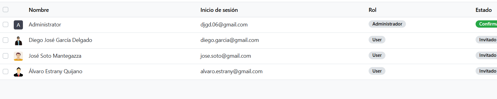
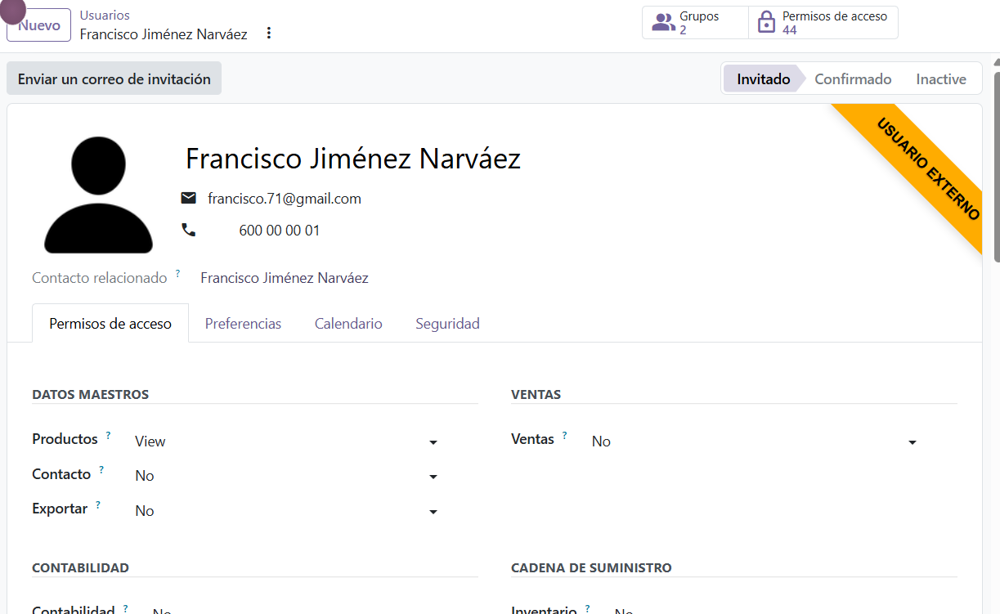

# Tipos de usuarios

## Interno
Estos usuarios son los que se encuentran en Odoo y cuentan con acceso al backend. Este observa y se encargaq de gestionar los módulos en base a los permisos con los que cuente. Los usuarios con los que cuento yo son:

- Diego José García Delgado, como responable de ventas con el rol User y Ventas Administrador.

- José Soto Mantegazza, como comercial con el rol de User y Ventas Usuario: solo documentos propios.

- Álvaro Estrany Quijano, como Administración/Facturación con Rol User y Contabilidad Facturación.

## Portal
es el cliente o proveedor externo que tiene cuenta para entrar a Odoo, pero solo ve sus propios documentos, como presupuestos, pedidos y facturas, a través del portal web.

El usuario que tengo creado se trata de Francisco Jiménez Narváez, ya que es el cleinte particular con el que cuenta mi empresa. Desde el mismo usuario le concecí acceso al portal para hacerlo un usuario dentro de odoo.

## Público
Es el visitante anónimo de la web, sin cuenta ni inicio de sesión. No es un usuario que se cree en la base de datos, sino el usuario por defecto que Odoo usa para lo que se ve sin iniciar sesión.