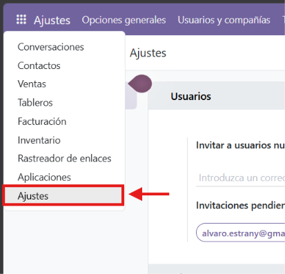
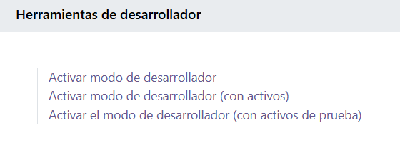
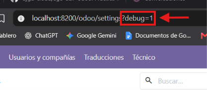
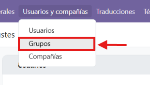
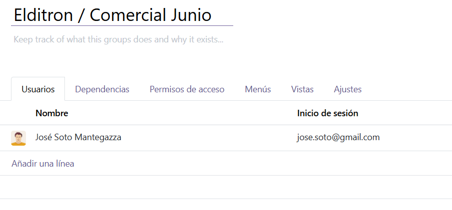
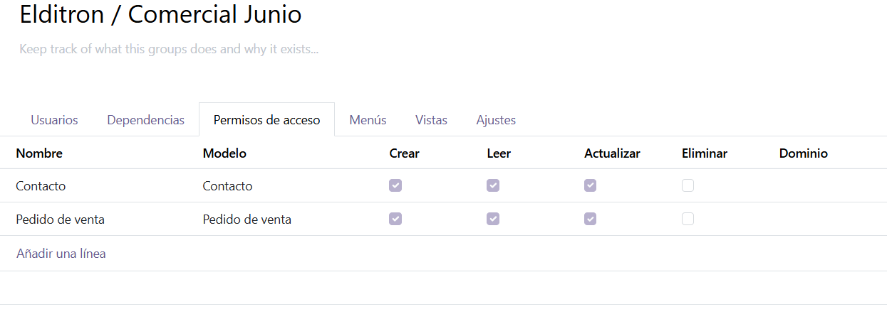
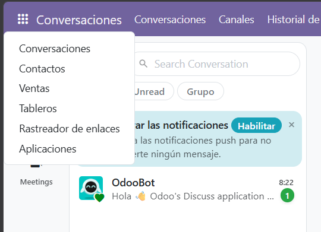
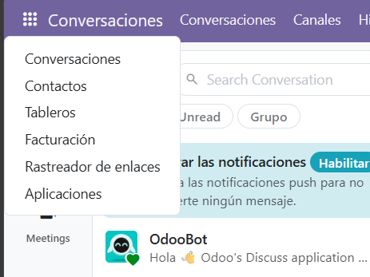
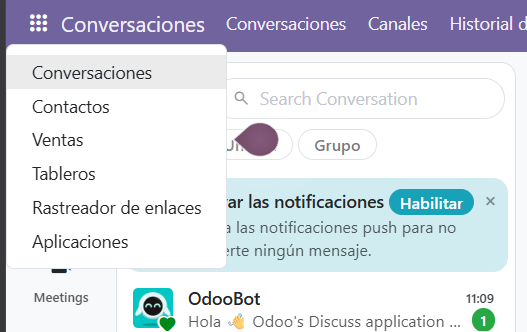

# Tipos de usuarios

## Interno
Estos usuarios son los que se encuentran en Odoo y cuentan con acceso al backend. Este observa y se encargaq de gestionar los módulos en base a los permisos con los que cuente. Los usuarios con los que cuento yo son:

- Diego José García Delgado, como responable de ventas con el rol User y Ventas Administrador.

- José Soto Mantegazza, como comercial con el rol de User y Ventas Usuario: solo documentos propios.

- Álvaro Estrany Quijano, como Administración/Facturación con Rol User y Contabilidad Facturación.

## Portal
es el cliente o proveedor externo que tiene cuenta para entrar a Odoo, pero solo ve sus propios documentos, como presupuestos, pedidos y facturas, a través del portal web.

El usuario que tengo creado se trata de Francisco Jiménez Narváez, ya que es el cleinte particular con el que cuenta mi empresa. Desde el mismo usuario le concecí acceso al portal para hacerlo un usuario dentro de odoo.

## Público
Es el visitante anónimo de la web, sin cuenta ni inicio de sesión. No es un usuario que se cree en la base de datos, sino el usuario por defecto que Odoo usa para lo que se ve sin iniciar sesión.

# Modo desarrollador
Hay varias formas de activar el modo desarrollador dentro de tu base de datos de Odoo, una de ellas.

Una de ellas es yendose a Ajustes posteriormente activar el modo desde sección de herramientas de desarrollador.

Otra forma de hacerlo también es añadirle a tu URL el sufijo "?debug=1". Esto activa el modo desarrolador de forma automática.

# Creación de grupo
Para crear un grupo, dentro del modo desarrolador nos dirigiremos a Usuarios y compañías - Grupos.

Ahí pulsaremos el botón "Nuevo" y rellenaremos los credenciales del grupo que queremos con el nombre y los usuarios a los que queremos que permanezca.

Luego en Permisos de acceso si pulsamos "Añadir una línea" podremos concederle los acceso que queramos a esos usuarios.

# Comprobación de permisos
Ahora si nos metemos por ejemplo en el usuairo de José Soto que es el usuario comercial y se encuentra en el grupo Elditron / Comercial Junior.

Este usuario puede crear un presupuesto y ver sus propios documentos pero no puede acceder a contabilidad por ejemplo.

Luego los datos que me saldrán con Álvaro Estrany serán los de un contable que se encarga de la facturación.

Por último estos son los valores que me salen con Diego José García que es el administrador.

