# Proceso de venta completo: del presupuesto a la factura
A continuación explicaré como se hace un proceso de venta en mi base de datos Odoo, lo haré desde el presupuesto hasta la factura.

## Comercial
Una empresa de hostelería nos ha hecho un encargo de una cámara IP, un switch de 8 puertos y un mantenimiento remoto.
Son 2 almacenables y 1 servicio, para crear el presupuesto iniciaremos como nuestro usuario comercial que es José Soto y nos dirigiremos a Ventas - Presupuestos - Nuevo.

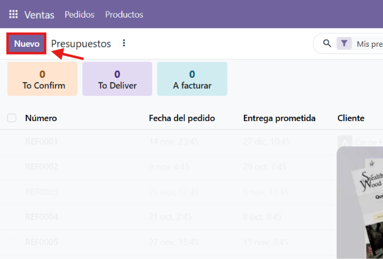

Ahí asignaremos datos como el cliente destinado, la fecha de validez y los productos y servicios.

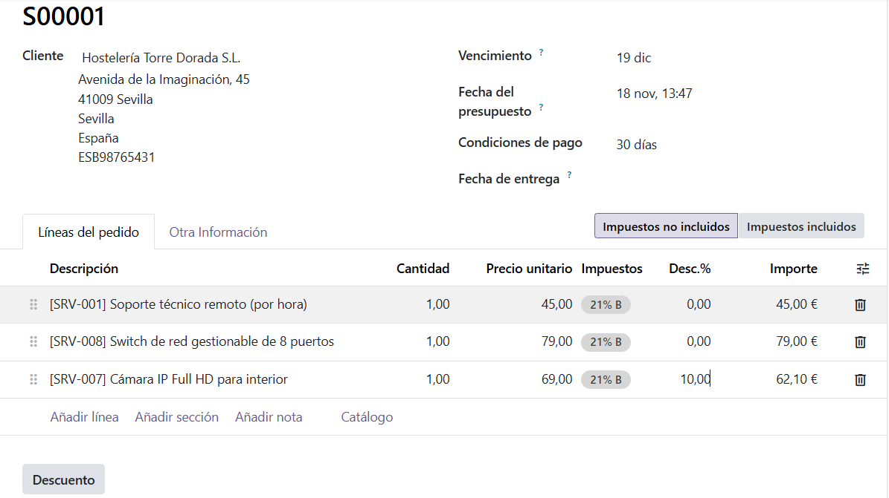

Después de ello lo imprimiremos por PDF en el botón de Descargar.

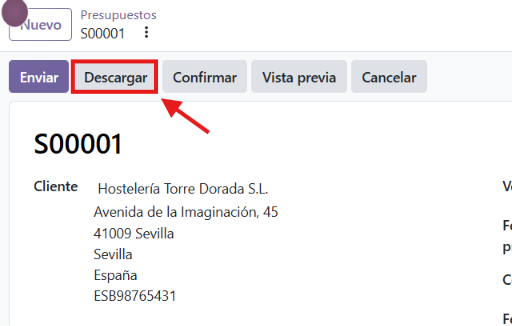

## Responsable de ventas
Después de eso, cambiaremos a nuestro usuario responsable de ventas que es Diego José García y confirmaremos desde eñ botón de Confirmar.

## Administrador
Ahora iniciaremos nuestro usuario de Administrador y verificamos que se haya creado correctamente el pedido de venta.

Nos dirigimos a Inventario - Operaciones - Entregas.

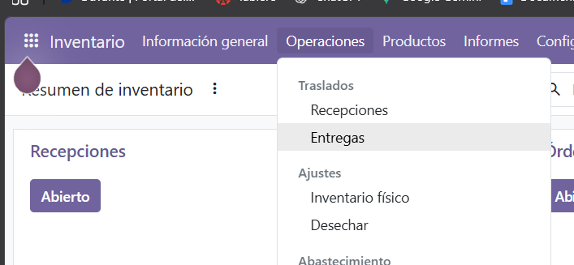

Aquí veremos los pedidos de venta que tenemos pendientes de entregar, donde entre ellos se encuentra el que creamos con anteriorridad denomonado como S00003.

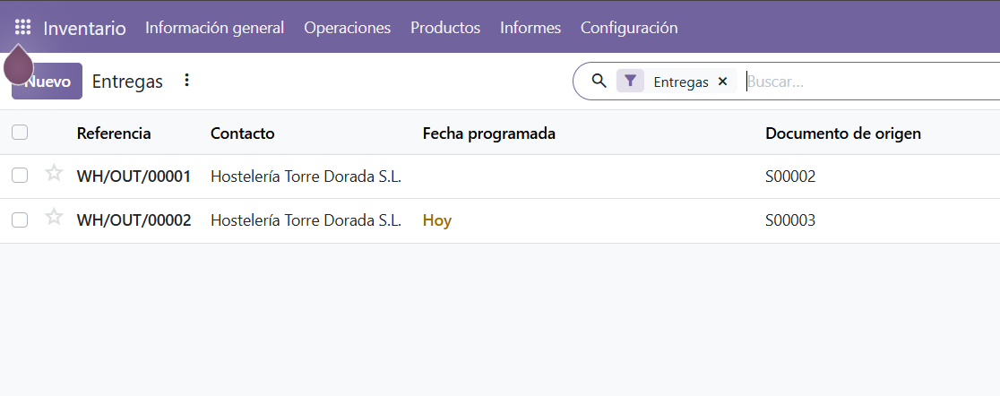

Si nos metemos dentro del pedido de venta se nos mostrarán los almacenables que se entregan en nuestro pedido junto con demás datos.

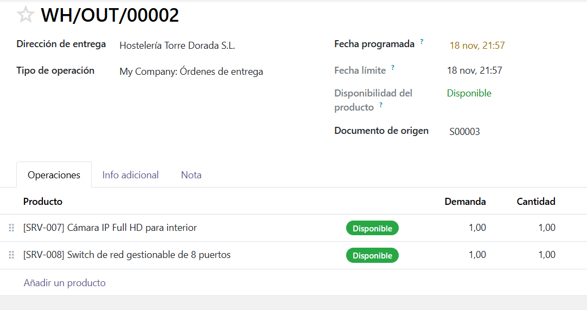

Por último crearemos una factura de nuestro pedido pulsando el botón que se encuentra en el menú.

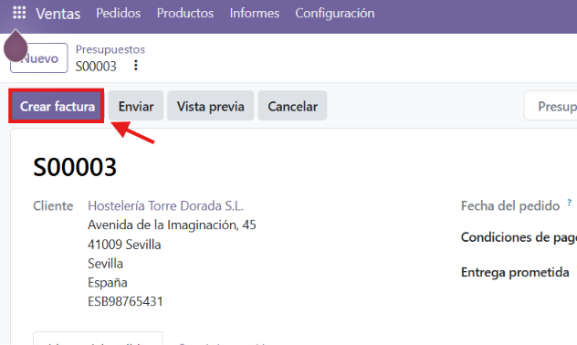

## Administración y facturación
Como acto final, nos cambiamos al usuario de facturación, en mi caso Álvaro Estrany y empezaremos el proceso de creación de la faactura. 

Nos movemos a Facturación - Clientes - Facturas.

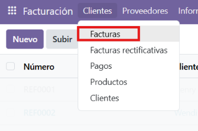

En ese menú nos saldrá nuestro pedido.

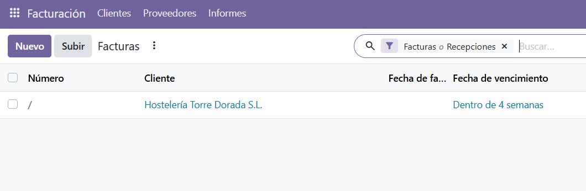

Nos dará la opción confirmar facturación.

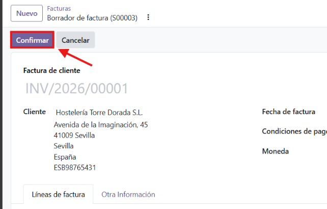

Después haremos un pago con la vía de transfereciía desde el botón de Pagar.

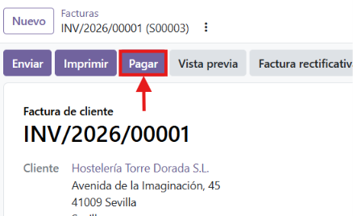

Por último imprimiremos un PDF de Facturación y así tendría que quedar nuestra factura ya pagada.

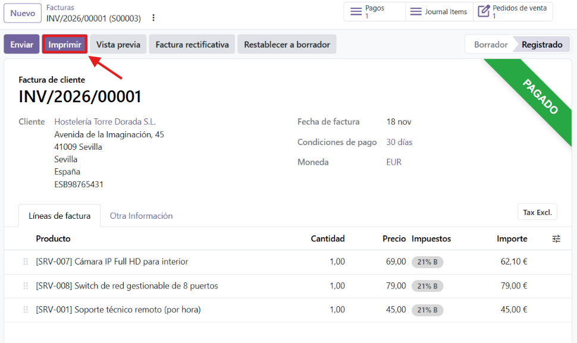

